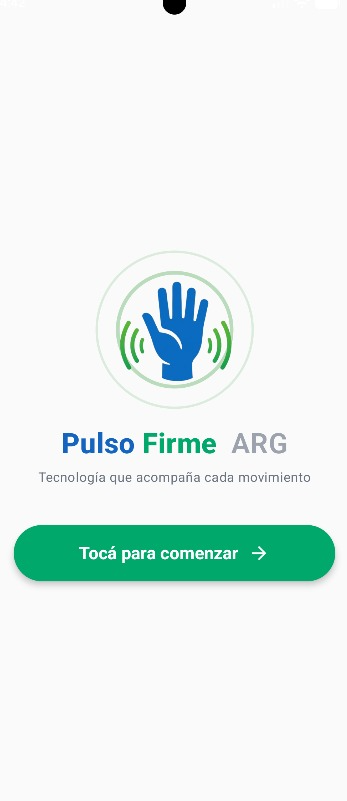
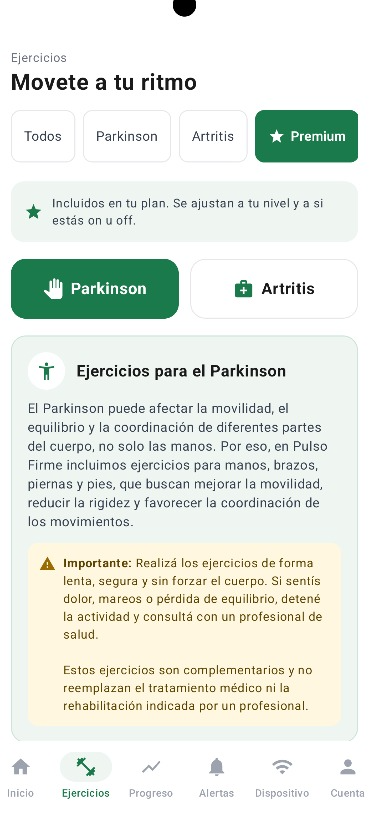
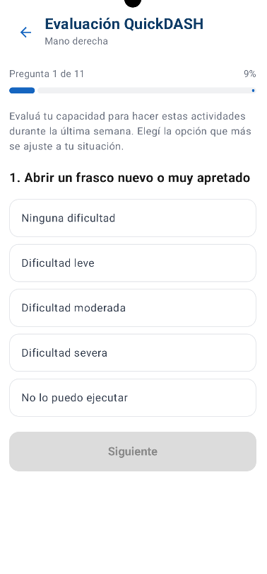
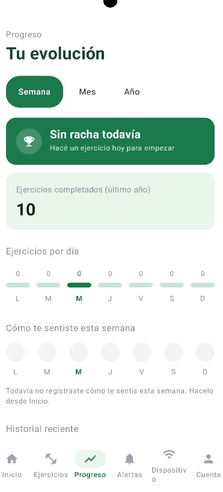
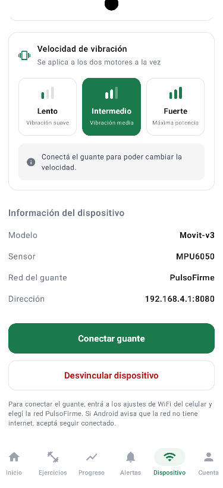
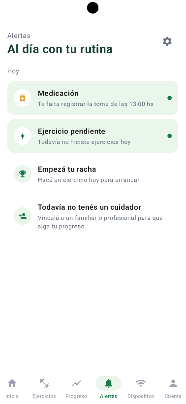
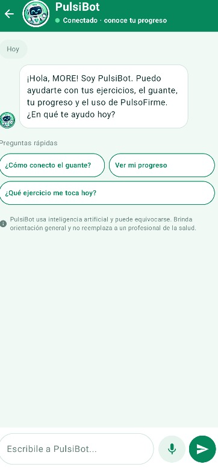
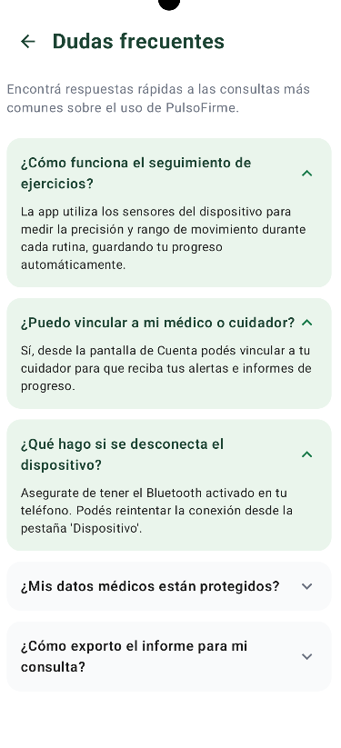
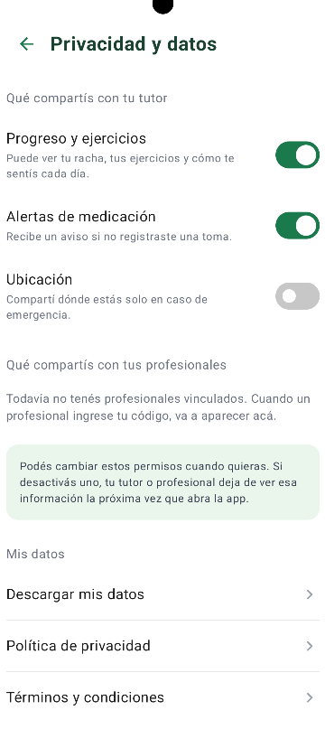
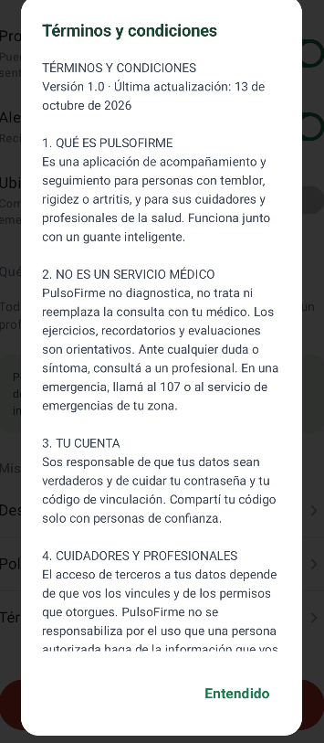

  

# PulsoFirme

PulsoFirme es una app para Android que hicimos como proyecto en la Escuela Experimental PROA de Alta Gracia. Está pensada para personas con Parkinson o artritis que necesitan hacer ejercicios de mano todos los días, y funciona junto con un guante que armamos nosotros.

La idea surgió de algo simple: los ejercicios de rehabilitación se hacen en casa, muchas veces solos, y es fácil dejarlos o no saber si se están haciendo bien. Con la app la persona sigue rutinas guiadas, anota cómo se siente y puede compartir su progreso con un familiar o con su médico.

## Capturas

  
  
  
  
  

  
  
  
  
  

## Cómo funciona

Hay tres tipos de cuenta:

- **Paciente:** hace los ejercicios, conecta el guante, registra la medicación y cómo se siente cada día, y completa el cuestionario QuickDASH.
- **Tutor o familiar:** se vincula con un código que le pasa el paciente, ve su progreso y recibe avisos, por ejemplo si se olvidó la medicación o si lleva varios días sin hacer ejercicio.
- **Profesional:** puede seguir a varios pacientes y ver cómo evolucionan.

El paciente decide qué información ve cada uno, y puede descargar o borrar sus datos cuando quiera.

Algunas cosas que agregamos:

- Las rutinas cambian de dificultad según cómo está la persona ese día y si la medicación está haciendo efecto o no.
- Recordatorios de ejercicio y alarmas de medicación que suenan aunque el celular esté bloqueado.
- PulsiBot, un asistente que responde dudas sobre la app.
- Un resumen semanal en PDF para llevarle al médico.
- Opciones de accesibilidad: letra grande, alto contraste, botones más grandes y soporte para TalkBack.
- Modo oscuro, y la app está en español y en inglés.

PulsoFirme acompaña el tratamiento, pero no lo reemplaza. Los ejercicios siempre tienen que estar indicados por un profesional.

## Con qué está hecha

La app está escrita en Kotlin con Jetpack Compose. Para las cuentas y los datos usamos Firebase (Authentication y Firestore), y PulsiBot funciona con Gemini a través de Firebase AI Logic. Los recordatorios y los avisos al tutor corren en segundo plano con WorkManager y AlarmManager.

El guante tiene sensores de movimiento (MPU6050) y se conecta con el celular por WiFi.

## Probarla

1. Cloná el repositorio y abrilo con Android Studio.
2. Creá un proyecto en Firebase, agregá una app Android con el paquete `com.example.pulsofirme` y poné el archivo `google-services.json` dentro de la carpeta `app/`.
3. Activá Authentication (correo y contraseña), Firestore y AI Logic.
4. Corré la app en un celular o emulador con Android 7.0 o más.

## Equipo

- Ivan Correa
- Gustavo Carrasco
- Ana Cabagna
- Morena Martínez

Si tenés alguna duda, escribinos a holapulsofirmearg@gmail.com.